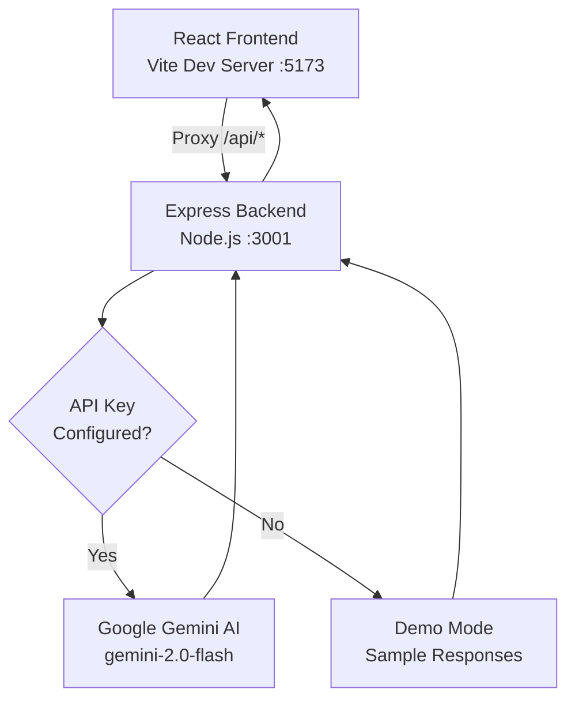

# GenAI Study Buddy 🎓

> An AI-powered study assistant that helps students understand material, summarize notes, generate quizzes, and craft better prompts — powered by Google Gemini AI.

[](README.md)
[](README.md)
[](README.md)

---

## 📋 Overview

GenAI Study Buddy is a full-stack web application that integrates Google's Gemini AI to provide students with four AI-powered study tools:

- **Notes Summarizer** — Convert long study notes into concise summaries, bullet points, or key concept lists
- **Quiz Generator** — Generate interactive multiple-choice quizzes from any study material
- **Study Chat** — Get instant, AI-generated explanations for any academic topic
- **Prompt Assistant** — Transform basic prompts into detailed, structured queries that get better AI results

The app includes a **Demo Mode** that works without any API key, making it easy to explore and test locally.

---

## ✨ Features

| Feature | Description |
|---|---|
| 📝 Notes Summarizer | Short, Detailed, Bullet-point, or Key Concept summaries |
| ❓ Quiz Generator | 5 or 10 questions, Easy/Medium/Hard difficulty, with explanations |
| 💬 Study Chat | Conversational AI tutor with chat history |
| 🪄 Prompt Assistant | Improve prompts for Learning, Summarization, Coding, or Quiz creation |
| 🟡 Demo Mode | Fully functional with sample responses — no API key required |
| 📱 Responsive | Works on mobile, tablet, and desktop |
| 🔒 Secure | API key never exposed to the frontend |

---

## 🛠 Technology Stack

| Layer | Technology |
|---|---|
| Frontend | React 18 + Vite |
| Styling | Vanilla CSS with CSS custom properties |
| Backend | Node.js + Express.js |
| AI | Google Gemini API (`@google/genai` SDK) |
| Icons | Lucide React |
| Markdown | react-markdown |
| Config | dotenv |

---

## 🏗 Architecture



---

## 📁 Project Structure

```
genai-study-buddy/
├── client/                     # React frontend (Vite)
│   ├── public/
│   │   └── favicon.svg
│   ├── src/
│   │   ├── components/
│   │   │   ├── CopyButton.jsx       # Copy-to-clipboard component
│   │   │   └── SharedComponents.jsx # Alerts, loading states
│   │   ├── pages/
│   │   │   ├── Dashboard.jsx        # Landing page with feature cards
│   │   │   ├── Summarizer.jsx       # Notes Summarizer
│   │   │   ├── QuizGenerator.jsx    # Interactive Quiz
│   │   │   ├── StudyChat.jsx        # AI Chat interface
│   │   │   └── PromptAssistant.jsx  # Prompt improvement tool
│   │   ├── utils/
│   │   │   └── api.js               # API client utility
│   │   ├── App.jsx                  # Root component with routing + sidebar
│   │   ├── index.css                # Global design system
│   │   └── main.jsx                 # React entry point
│   ├── index.html
│   ├── vite.config.js
│   └── package.json
│
├── server/                     # Express backend
│   ├── index.js                # Server entry point + all routes
│   ├── .env.example            # Environment template
│   └── package.json
│
├── .gitignore
├── package.json                # Root scripts
└── README.md
```

---

## ⚙️ Prerequisites

- **Node.js** v18 or later
- **npm** v8 or later
- A **Google Gemini API key** *(optional — Demo Mode works without one)*

---

## 🚀 Installation

### 1. Clone the repository

```bash
git clone https://github.com/YOUR_USERNAME/genai-study-buddy.git
cd genai-study-buddy
```

### 2. Install all dependencies

```bash
# Install server dependencies
cd server && npm install && cd ..

# Install client dependencies
cd client && npm install && cd ..
```

---

## 🔑 Configure the Gemini API Key

> **Demo Mode** works without any API key. Skip this section to use sample responses.

1. Get a free API key at [Google AI Studio](https://aistudio.google.com/app/apikey)
2. Copy the example environment file:
   ```bash
   cp server/.env.example server/.env
   ```
3. Edit `server/.env` and add your key:
   ```env
   GEMINI_API_KEY=your_actual_api_key_here
   ```

> ⚠️ **Security Note:** Never commit `.env` to version control. The `.gitignore` already excludes it.

---

## ▶️ Running the Application

You need **two terminal windows** — one for the backend, one for the frontend.

### Terminal 1 — Start the Backend

```bash
cd server
npm run dev
# Server runs on http://localhost:3001
```

### Terminal 2 — Start the Frontend

```bash
cd client
npm run dev
# Frontend runs on http://localhost:5173
```

Open [http://localhost:5173](http://localhost:5173) in your browser.

---

## 🟡 Demo Mode

When no `GEMINI_API_KEY` is configured (or the key is the placeholder value), the application automatically enters **Demo Mode**:

- A yellow "Demo Mode" badge appears in the sidebar and page header
- All four features return clearly labeled **sample responses**
- No API calls are made — no costs, no quotas
- Demo responses are educational and realistic, but always labeled with a ⚠️ notice

This allows the project to run and be explored by anyone without API credentials.

---

## 📡 API Endpoints

All endpoints are prefixed with `/api`.

### `GET /api/health`

Returns server status and current mode.

**Response:**
```json
{
  "status": "ok",
  "demoMode": true,
  "timestamp": "2024-01-01T00:00:00.000Z"
}
```

---

### `POST /api/summarize`

Summarizes study notes in the requested format.

**Request body:**
```json
{
  "text": "Your study notes here (min 10 chars, max 10,000)",
  "summaryType": "short" // "short" | "detailed" | "bullets" | "concepts"
}
```

**Response:**
```json
{
  "result": "**Short Summary**\n\nMarkdown formatted summary...",
  "demoMode": false
}
```

---

### `POST /api/quiz`

Generates a multiple-choice quiz from study material.

**Request body:**
```json
{
  "text": "Study material (min 10 chars, max 10,000)",
  "questionCount": 5,      // 5 or 10
  "difficulty": "medium"   // "easy" | "medium" | "hard"
}
```

**Response:**
```json
{
  "questions": [
    {
      "question": "What is...?",
      "options": ["Option A", "Option B", "Option C", "Option D"],
      "correct": 0,
      "explanation": "Because..."
    }
  ],
  "difficulty": "medium",
  "demoMode": false
}
```

---

### `POST /api/chat`

Gets an AI-generated response to a study question.

**Request body:**
```json
{
  "message": "Explain photosynthesis (min 10, max 2,000 chars)",
  "history": [
    { "role": "user", "content": "Previous message" },
    { "role": "ai", "content": "Previous response" }
  ]
}
```

**Response:**
```json
{
  "reply": "Markdown formatted explanation...",
  "demoMode": false
}
```

---

### `POST /api/improve-prompt`

Improves a basic AI prompt.

**Request body:**
```json
{
  "prompt": "Explain machine learning (min 10, max 2,000 chars)",
  "purpose": "learning" // "learning" | "summarization" | "coding" | "quiz"
}
```

**Response:**
```json
{
  "improved": "Improved, detailed prompt...",
  "explanation": "Markdown explanation of improvements...",
  "demoMode": false
}
```

---

## 🔒 Security Notes

- The Gemini API key is stored **server-side only** in `server/.env`
- The key is **never sent** to the frontend, included in API responses, or logged
- All user input is validated and length-limited server-side
- CORS is configured to allow only the frontend origin
- The `.gitignore` excludes `.env`, `node_modules`, and build artifacts

---

## 🔧 Building for Production

```bash
# Build the frontend
cd client && npm run build

# The built files will be in client/dist/
# Serve with the Express server or any static host
```

---

## 🚀 Future Improvements

- [ ] User authentication with study session history
- [ ] PDF/document upload for notes input
- [ ] Flashcard generation from study material
- [ ] Spaced repetition quiz scheduling
- [ ] Export quizzes and summaries as PDF
- [ ] Dark mode toggle
- [ ] Multiple language support
- [ ] Teacher/student dashboard mode

---

## 📄 License

MIT License — feel free to use this project for learning, portfolios, or as a starting point for your own AI applications.

---

*Built as a student portfolio project demonstrating Generative AI integration with React and Node.js.*
